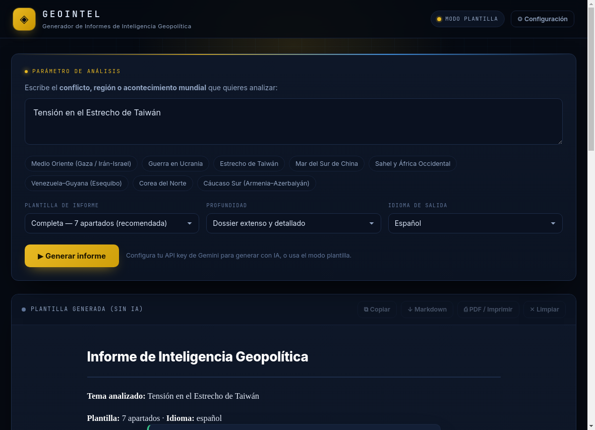

# ◈ Geo Intel by TheFirm

**Generador de Informes de Inteligencia Geopolítica con IA (Google Gemini)** — aplicación de escritorio para macOS.

Escribes un conflicto, región o acontecimiento mundial y Geo Intel by TheFirm construye automáticamente un informe estructurado de análisis geopolítico (7, 6 o 5 apartados) usando la API de Google Gemini.




---

## ✨ Características

- **Interfaz de escritorio nativa** para macOS (Electron), instalable como `.app` / `.dmg`.
- **Motor de IA: Google Gemini** (streaming en tiempo real) con los **modelos más recientes** (Gemini 4 Argon, 3.8 Flash, 3.6 Flash, 3.5 Flash-Lite…).
- **Informes anclados a HOY** 📅: la app inyecta la **fecha actual del sistema** en cada consulta y prohíbe expresamente presentar como «actuales» hechos de años anteriores (2023, 2024, 2025…). Los informes describen la situación tal como está hoy.
- **Búsqueda en Google en tiempo real** 🌐: activa la herramienta *Grounding with Google Search* para que el informe se base en **noticias y hechos actuales**, con las **fuentes citadas** visibles en el panel «Fuentes y búsquedas en vivo».
- **Lectura de una noticia por enlace** 🔗: pega el **enlace de una noticia** y Geo Intel by TheFirm **lee su contenido** (herramienta *URL context*) y además **busca otras noticias relacionadas** en Google para construir el informe.
- **Noticias reales con World News API** 📰: antes de redactar, la app **busca noticias actuales** en miles de medios de todo el mundo (World News API), las **ordena por relevancia** respecto a tu tema y las **inyecta en el prompt** para anclar el informe en hechos verificables. Al final del informe se muestra una **galería de noticias** con titular, medio, fecha, sentimiento y enlace, y sus imágenes alimentan la **galería de fotos**.
- **Conmutación automática (fallback)**: si el modelo elegido falla o no está disponible, la app reintenta sola con el siguiente modelo de la cadena.
- **Nivel de razonamiento ajustable** (thinking level): auto, bajo, medio o alto.
- **3 plantillas de informe**: completa (7 apartados), ampliada (6) y ejecutiva (5).
- **Profundidad ajustable**: dossier extenso (2.500–4.000 palabras) o informe ejecutivo (900–1.400).
- **4 idiomas de salida**: español, inglés, portugués y francés.
- **Modo plantilla sin API key**: genera el esqueleto del informe aunque no tengas clave.
- **Exportación**: copiar al portapapeles, descargar en Markdown y PDF/Imprimir.
- **Privado**: tu API key se guarda solo en tu equipo, nunca se envía a terceros.

---

## 📋 Requisitos

- **macOS** 11 (Big Sur) o superior.
- **Node.js 18+** (recomendado 20 o 22) y **npm**. Descárgalo en <https://nodejs.org>.
- Una **API key de Google Gemini** (gratuita) → <https://aistudio.google.com/app/apikey>.
- *(Opcional)* Una **API key de World News API** (gratuita) → <https://worldnewsapi.com/> — para la búsqueda de noticias reales.

Para comprobar que tienes Node instalado, abre **Terminal** y ejecuta:

```bash
node -v
npm -v
```

---

## 🚀 Instalación y uso (modo desarrollo)

```bash
# 1. Clona el repositorio
git clone https://github.com/angelsinger1976-arch/geointel.git
cd geointel

# 2. Instala las dependencias
npm install

# 3. Arranca la aplicación
npm start
```

Al abrirse la app:

1. Pulsa **⚙ Configuración**.
2. Pega tu **API Key de Gemini**, elige un **modelo principal** (por defecto `gemini-3.8-flash`) y, si quieres, un **nivel de razonamiento**. Deja marcada la casilla **«Buscar en Google en tiempo real»** para que el informe use noticias actuales.
3. *(Opcional)* En la sección **«📰 Noticias reales · World News API»**, pega tu **API key de World News API** y deja marcada la casilla **«Buscar noticias reales antes de generar»** para que el informe se ancle en titulares verificables.
4. Pulsa **Guardar**.
5. Escribe un conflicto o región. *(Opcional)* Pega el **enlace de una noticia** en el campo «Enlace de una noticia».
6. Pulsa **▶ Generar informe**.

> 🔁 **Fallback automático:** si el modelo principal falla (no disponible, saturado o error), Geo Intel by TheFirm reintenta automáticamente con los siguientes modelos de la cadena, sin que tengas que hacer nada. La barra de estado muestra el modelo que está usando en cada momento.

> 💡 Si no introduces ninguna API key, la app funciona igualmente en **modo plantilla**: genera el esqueleto completo del informe con tu tema insertado.

---

## 📅🌐 Informes actuales: fecha de hoy + búsqueda en vivo

Geo Intel by TheFirm está diseñado para que **nunca** te devuelva un informe «congelado» en el pasado:

- **Fecha dinámica:** cada vez que generas un informe, la app calcula la **fecha actual del sistema** y la inyecta tanto en el *system prompt* como en la consulta. El informe se titula con la fecha real (p. ej. *«Fecha del informe: lunes, 19 de octubre de 2026»*) y el modelo tiene **prohibido** presentar como vigentes hechos de años anteriores.
- **Grounding con Google Search:** con la casilla **«Buscar en Google en tiempo real»** activada, Gemini consulta Google antes de redactar. El informe se apoya en **noticias y hechos del momento** y la app muestra un panel con las **consultas realizadas**, los **enlaces leídos** y las **fuentes web citadas**.
- **Enlace de noticia (URL context):** si pegas el enlace de una noticia, Geo Intel by TheFirm **lee su contenido** y, además, **busca en Google otras noticias y hechos recientes** relacionados, los contrasta con la noticia de partida y construye el informe con todo ello.

### 🔗 Cómo usar el enlace de una noticia

1. Copia la URL de una noticia (por ejemplo de Reuters, AP, El País, Al Jazeera…).
2. Pégala en el campo **«Enlace de una noticia (opcional)»**.
3. *(Recomendado)* Deja marcada la casilla **«Buscar en Google en tiempo real»**.
4. Pulsa **▶ Generar informe**.

La app pedirá al modelo que, en este orden: **1)** lea el contenido del enlace, **2)** busque en Google noticias **más recientes** sobre el mismo tema, **3)** contraste la información y **4)** integre todo en el informe. Al terminar verás el panel **«Fuentes y búsquedas en vivo»** con las consultas, los enlaces leídos (con etiqueta *LEÍDO*) y las fuentes citadas.

> ⚠️ La herramienta de lectura de enlaces no funciona con **muros de pago**, vídeos de YouTube ni archivos de Google Workspace. Si un enlace no se puede leer, la app lo indica y continúa con la búsqueda en Google.

---

## 📰 Noticias reales con World News API

Además del *grounding* de Google, Geo Intel by TheFirm puede buscar **noticias reales y recientes** en la **[World News API](https://worldnewsapi.com/)**, que agrega miles de medios internacionales. Es la forma más directa de que el informe se apoye en **titulares verificables con enlace a la fuente**.

### Cómo activarlo

1. Crea una cuenta gratuita en <https://worldnewsapi.com/> y copia tu **API key**.
2. Pulsa **⚙ Configuración** y, en la sección **«📰 Noticias reales · World News API»**, pega la clave.
3. Ajusta las opciones (opcionales):
   - **Nº de noticias** a recuperar (20, 40, 60 o 100; por defecto **40**).
   - **Idioma** de las noticias (*Automático*, español, inglés, portugués o francés).
4. Deja marcada la casilla **«Buscar noticias reales antes de generar»** y pulsa **Guardar**.

### Cómo funciona

- Al pulsar **▶ Generar informe**, la app **extrae las palabras clave** de tu tema (filtrando términos genéricos y vacíos), construye una **consulta precisa** y la lanza contra el endpoint `search-news` (ordenado por fecha de publicación descendente).
- Los resultados se **puntúan por relevancia** (el título pesa más que el resumen y que el cuerpo) y se seleccionan los **12 mejores**.
- Esos titulares se **inyectan en el prompt** como un bloque de *contexto de actualidad*, de modo que Gemini redacta el informe apoyándose en **hechos del momento** y no solo en su conocimiento interno.
- Al final del informe aparece la sección **«📰 Noticias recientes (World News API)»** con una tarjeta por noticia: **miniatura, medio, fecha, etiqueta de sentimiento** (positivo/negativo/neutro) y **enlace**. Las imágenes de las noticias se usan además para la **galería de fotos** del informe.
- Las noticias también se incluyen en la **exportación a Markdown** (como enlaces) y en la lista de **fuentes**.

### Cuota y límites (plan gratuito)

- El plan gratuito incluye **50 puntos/día** (se reinician a medianoche UTC). Cada búsqueda consume **1 punto + 0,01 por resultado**; por ejemplo, una búsqueda de 40 noticias ≈ **1,4 puntos**.
- Límite de **60 peticiones/minuto** y **1 petición concurrente** en el plan gratuito.
- Si la clave falta, es incorrecta o se agota la cuota, la app **avisa con un mensaje** y **continúa** con la generación normal (la búsqueda de noticias es opcional y nunca bloquea el informe).

> ⚠️ La búsqueda de noticias es **complementaria**: si la desactivas o falla, Geo Intel by TheFirm sigue funcionando con el *grounding* de Google y el modelo Gemini.

---

## 📦 Crear la aplicación instalable (.dmg / .app)

Para generar un instalador de macOS:

```bash
npm run dist
```

Esto crea en la carpeta `dist/`:

- `Geo Intel by TheFirm-1.2.0.dmg` → instalador arrastrable a *Aplicaciones*.
- `Geo Intel by TheFirm-1.2.0-mac.zip` → versión comprimida de la app.

También puedes usar:

```bash
npm run pack        # empaqueta sin generar el .dmg (más rápido)
npm run dist:dmg    # genera solo el .dmg
```

### ⚠️ Primera apertura (app sin firmar)

La app **no está firmada** con un certificado de Apple, así que macOS mostrará un aviso la primera vez. Para abrirla:

1. Abre el `.dmg` y arrastra **Geo Intel by TheFirm** a la carpeta **Aplicaciones**.
2. En *Aplicaciones*, haz **clic derecho → Abrir** sobre Geo Intel by TheFirm y confirma **Abrir**.
   - (Solo hace falta la primera vez.)

Si macOS sigue bloqueándola, ejecuta en Terminal:

```bash
xattr -cr /Applications/Geo Intel by TheFirm.app
```

---

## 🔑 Obtener la API key de Gemini

1. Entra en <https://aistudio.google.com/app/apikey> con tu cuenta de Google.
2. Pulsa **Create API key**.
3. Copia la clave (empieza por `AIza…`) y pégala en ⚙ Configuración de la app.

El nivel gratuito de Gemini es suficiente para uso personal.

---

## 🗂️ Estructura del proyecto

```
geointel/
├── main.js              # Proceso principal de Electron + integración con Gemini (streaming)
├── preload.js           # Puente seguro (contextBridge) hacia el renderer
├── package.json         # Dependencias y configuración de empaquetado
├── renderer/
│   ├── index.html       # Interfaz de usuario
│   ├── styles.css       # Diseño (tema "centro de mando")
│   ├── app.js           # Lógica de la interfaz y plantillas de prompt
│   ├── news-util.js     # Utilidades de noticias (keywords, ranking, normalización)
│   └── vendor/
│       └── marked.min.js # Parser Markdown (local, funciona sin conexión)
├── assets/
│   └── icon.png         # Icono de la aplicación
├── LICENSE              # MIT
└── README.md
```

---

## 🧠 Cómo funciona

1. Escribes el tema (y, opcionalmente, el enlace de una noticia) y eliges plantilla, profundidad e idioma.
2. *(Opcional)* Si la **búsqueda de noticias** está activada, la app consulta la **World News API**, puntúa y selecciona las noticias más relevantes para tu tema.
3. La app construye un **prompt maestro** (persona de analista senior + condiciones de rigor + apartados), **inyecta la fecha actual del sistema** con instrucciones explícitas de frescura y, si hay, el **bloque de noticias recientes**.
4. El proceso principal de Electron envía el prompt a la API de **Gemini** (`streamGenerateContent`) y transmite la respuesta en streaming. Cuando está activada la búsqueda, adjunta las herramientas **`googleSearch`** (grounding en Google) y **`urlContext`** (lectura del enlace de noticia).
5. Gemini consulta Google y/o lee el enlace, y devuelve la respuesta junto con su **metadata de grounding** (consultas, enlaces leídos y fuentes citadas), que la app muestra en el panel lateral.
6. Si el modelo principal devuelve un error antes de emitir texto, la app **reintenta con el siguiente modelo de la cadena** (fallback) y, como red de seguridad, vuelve a intentarlo sin herramientas si estas provocaran un fallo.
7. Al terminar, la app añade los **extras del informe**: la **galería de noticias** (World News API), la **galería de fotos**, el **mapa** de la región y la **lista de fuentes**.
8. El texto se renderiza en Markdown y puede exportarse a PDF o Markdown.

---

## 🤖 Modelos soportados (2026)

La app usa los modelos vigentes de la familia Gemini 3.x / 4.x:

| Modelo | Endpoint | Notas |
| --- | --- | --- |
| Gemini 4 Argon | `gemini-4-argon` | Máxima capacidad de razonamiento (1M de contexto). |
| Gemini 3.8 Flash | `gemini-3.8-flash` | **Recomendado.** El Flash más inteligente. |
| Gemini 3.6 Flash | `gemini-3.6-flash` | Flash de generación anterior, estable. |
| Gemini 3.5 Flash-Lite | `gemini-3.5-flash-lite` | El más rápido y económico. |
| Gemini 3.1 Flash-Lite | `gemini-3.1-flash-lite` | Rendimiento alto a bajo coste. |
| Gemini 3.1 Pro | `gemini-3.1-pro-preview` | Preview de la serie Pro. |
| Gemini 3 Flash | `gemini-3-flash-preview` | Preview. |

**Cadena de fallback:** `gemini-4-argon → gemini-3.8-flash → gemini-3.6-flash → gemini-3.5-flash-lite → gemini-3.1-flash-lite → gemini-3.1-pro-preview → gemini-3-flash-preview`.

> ℹ️ Los modelos Gemini 2.0 y 1.5 están **apagados**, y los 2.5 tienen **acceso limitado**; por eso Geo Intel by TheFirm ya no los usa. Además, los parámetros `temperature`, `top_p` y `top_k` están **deprecados** en los modelos nuevos (provocan error 400), así que la app no los envía: el control de creatividad se sustituye por el **nivel de razonamiento** (`thinkingLevel`).

---

## 🔒 Privacidad

- La API key se almacena localmente en la carpeta de datos de la app (`userData/config.json`) y **nunca** se envía a servidores distintos de la propia API de Google Gemini.
- Si activas la **búsqueda de noticias**, tu **API key de World News API** se guarda también localmente y se envía **únicamente** a `api.worldnewsapi.com` para realizar la consulta. No se usa para ningún otro fin.
- La app no recopila telemetría ni datos de uso.

---

## 📄 Licencia

Distribuido bajo licencia **MIT**. Consulta [LICENSE](LICENSE).

---

## ⚖️ Aviso

Geo Intel by TheFirm es una herramienta de apoyo analítico. Los informes generados por IA pueden contener imprecisiones; verifica siempre los datos con fuentes primarias antes de tomar decisiones.
